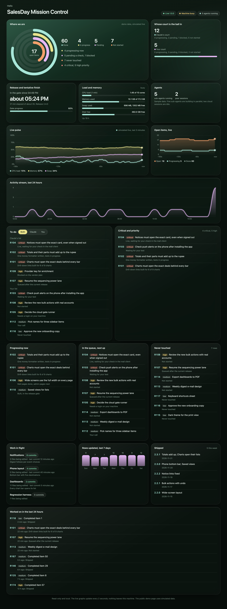

# SalesDay Mission Control

A real-time, glass-finished dashboard for building a product with an AI assistant. **[Live](https://mission-control-production-f6bba4c5.up.railway.app)** (simulated data, it moves). One page tells you:

- **Live moving graphs**: CPU load, memory and swap scrolling in real time, an open-items stream, and a 24-hour activity curve
- **Where we are**: done, in progress, pending a check, blocked, not started, as concentric rings
- **Whose court the ball is in**: the assistant's open items versus yours, with the split by state
- **Agents**: how many sub-agents and peer sessions are running
- **To-do lists** for both of you, ordered by priority
- **Critical and high priority** items at a glance
- **Progressing now**, **in the queue**, and **never touched**
- **Release and tentative finish**: when the current release gate started, how far along it is, and when it is expected to finish
- **Load and memory**: CPU load, memory, swap and disk, with a health pill (healthy, busy, critical)
- **Shipped**: the last releases from your changelog, and a seven-day activity chart
- **Worked on in the last 24 hours**




It is one small Node file and one HTML page. **No dependencies, no build step, nothing leaves your machine.** The server is read-only and listens on `127.0.0.1` only.

## Try it in 10 seconds

```bash
git clone https://github.com/harish-e-g/salesday-mission-control.git
cd salesday-mission-control
npm run demo        # synthetic data, opens on http://127.0.0.1:4378
```

## Use it on your own project

1. Copy `mission.config.example.json` to `mission.config.json` (it is git-ignored, so your data never gets committed) and point it at your folders:

```json
{
  "project": "My product",
  "owner": "Sam",
  "ballLabels": { "ai": "Claude", "you": "You" },
  "rowsDir": "~/work/mission/rows",
  "agentsFile": "~/work/mission/agents.json",
  "liveUrl": "https://example.com/api/version",
  "lanes": [{ "name": "Billing rewrite", "path": "~/work/worktrees/billing", "base": "origin/main" }],
  "gate": { "statusGlob": "~/work/tmp/gate*.status", "averageMinutes": 35 },
  "changelogGit": { "repo": "~/work/product", "ref": "origin/main", "path": "CHANGELOG.md" }
}
```

2. Run `node server.js` and open `http://127.0.0.1:4378`.

### How the assistant talks to it

The dashboard reads plain files, so any assistant (or you) can update it. Each work item is one JSON file in `rowsDir`:

```json
{ "id": "R42", "ball": "AI", "pri": "critical", "status": "I", "req": "Charts must open the exact deals behind every bar", "fin": "Drill-down built for 6 of 9 charts", "est": "2 hours" }
```

| field | meaning |
|---|---|
| `ball` | `AI` (the assistant's court) or `You` |
| `pri` | `critical`, `high`, `medium`, `low` |
| `status` | `C` completed, `I` in progress, `P` pending a check, `B` blocked, `N` not started |
| `req` / `fin` | what was asked, and where it stands |

Tell your assistant (for example in `CLAUDE.md`): *"After every release or lane report, update the matching row file in `rowsDir` and `agents.json`."* The page picks the change up within five seconds.

`agents.json` is `{ "running": 5, "peers": 2, "note": "..." }`.

### Your product

Set `liveUrl` to any endpoint that returns `{ "version": "x.y.z" }` and the header shows what is live. `lanes` are git work trees (commits ahead of the base branch, files being edited, latest commit titles). `gate` watches a status file that a release script writes (`DONE_OK` or `DONE_FAIL`), and estimates the finish time from the average gate length.

## Privacy

The demo data is made up. Your own rows, folders and URLs stay in `mission.config.json` and your row files, neither of which is committed. The page is served to localhost only and makes no network calls except the optional `liveUrl`.

## License

MIT


## Sharing it publicly (hosted copy)

`server.js` also runs as a hosted copy (`MC_HOSTED=1`, `MC_INGEST_TOKEN=<secret>`). It holds no data of its own: `scripts/publish.js` runs on the machine that has the rows, masks e-mail addresses, links, phone numbers, folder paths, keys and any terms listed under `publish.maskTerms` (see `lib/redact.js`), and posts a snapshot every 2 seconds. The secret is read from `~/.config/salesday-mission-control/token` and never committed. If the publisher stops, the page shows a "Publisher offline" notice with the time of the last update.
