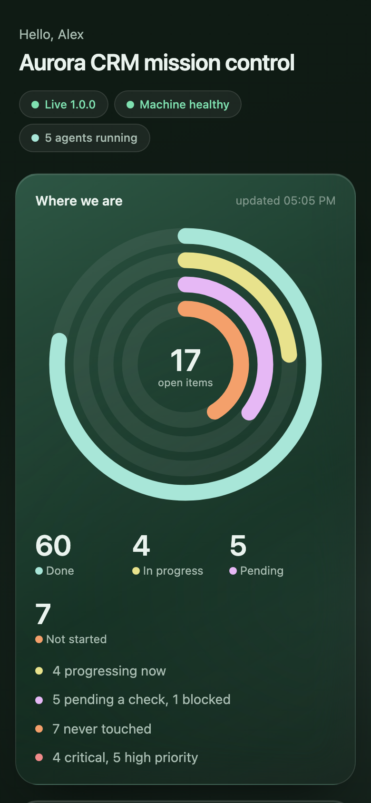

# SalesDay Mission Control

A live dashboard for building a product with an AI assistant. One page shows what is done, what is in progress, whose turn it is (yours or the assistant's), how many agents are running, and when the next release should finish.

**Live page:** https://mission-control-production-f6bba4c5.up.railway.app

The live page shows real data from an ongoing build. E-mail addresses, links, phone numbers, folder paths and keys are masked before anything is published (see [Hosted mode](#hosted-mode-and-the-masking-publisher)). The project is built with the help of Claude, an AI assistant.




It is one small Node file and one HTML page. There are no dependencies and no build step. Run locally, the server is read-only and listens on `127.0.0.1` only.

## What it shows

- **Live graphs**: CPU load, memory and swap scrolling in real time, an open-items stream, and a 24-hour activity curve
- **Where we are**: done, in progress, pending a check, blocked and not started, as concentric rings
- **Whose court the ball is in**: the assistant's open items against yours, split by state
- **Agents**: how many sub-agents and peer sessions are running
- **To-do lists** for both sides, ordered by priority
- **Critical and high priority** items at a glance
- **Progressing now**, **in the queue** and **never touched**
- **Release and tentative finish**: when the current release gate started, how far along it is, and when it is expected to finish
- **Load and memory**: CPU load, memory, swap and disk, with a health pill (healthy, busy, critical)
- **Work in flight**: git work trees, with commits ahead of the base branch and files being edited
- **Shipped**: recent releases from your changelog, and a seven-day activity chart
- **Worked on in the last 24 hours**

## The AI agent team view (free to use)

Open `/team.html` (the "Agent team" button in the header). It is a live map of an **AI team**, not an organisation chart: every card is an AI agent, the orchestrator on top is the **agentic AI** layer that plans, delegates, remembers, verifies and asks a human, and the only human on the map is the owner.

- **AI agent flow:** a layered map (human, agentic AI orchestrator, department heads, specialists). One card size with four single lines: name, designation, department, status with time. Right-angle connectors that never cross text.
- **Live beats only where work is happening:** a moving dot travels to an agent that is *working*. Agents that are waiting on you (amber), idle (grey) or resting (violet) get no beat, only their own colour.
- **More views:** shift timeline (when each agent starts or rests), office floor, status board, load map. Five colour themes.
- **Your own agents:** copy `demo/team.json` to `team.config.json` (git-ignored), set `"teamFile": "./team.config.json"` in `mission.config.json`, and describe your agents. Each agent has `name`, `role`, `dept`, `icon`, `status` (`working`, `waiting`, `idle`, `resting`), `since`, `next` and optional `tags` that link to your rows. Times can be relative (`"-25m"`, `"+2h"`) or ISO.
- **Layout options:** `/layouts.html` shows five alternative flowchart layouts of the same data.

**Live mode (real data, nothing invented):** set `"teamSource": "claude-code"` in `mission.config.json`. The page then reads this machine's Claude Code activity: each session is an *agentic AI* card, each sub-agent it started is an *AI agent* card. Working = changed in the last two minutes; a session that just finished its turn is *waiting on you*; older ones are idle or resting. Names are friendly labels generated from the session id. Task text is never shown unless you set `"teamShowTasks": true`.

Try the sample in a minute: `node server.js --demo`, then open `http://localhost:4378/team.html`. The names, roles and tasks in `demo/team.json` are made up.

This project is free and open source under the MIT licence. Use it, change it, ship it, and build the same dashboard for your own AI agents.

## Requirements

Node 18 or newer. Nothing else to install.

## Try it locally

```bash
git clone https://github.com/harish-e-g/salesday-mission-control.git
cd salesday-mission-control
npm run demo        # builds synthetic data, then serves http://127.0.0.1:4378
```

The demo data is made up. `node server.js --demo` always uses it, which makes it safe for screenshots.

## Use it on your own project

1. Copy `mission.config.example.json` to `mission.config.json`. The file is git-ignored, so your data is never committed. Point it at your folders:

```json
{
  "project": "My product",
  "owner": "Sam",
  "ballLabels": { "ai": "Claude", "you": "You" },
  "rowsDir": "~/work/mission/rows",
  "agentsFile": "~/work/mission/agents.json",
  "liveUrl": "https://example.com/api/version",
  "lanes": [{ "name": "Billing rewrite", "path": "~/work/worktrees/billing", "base": "origin/main" }],
  "gate": { "statusGlob": "~/work/tmp/gate*.status", "averageMinutes": 35 },
  "changelogGit": { "repo": "~/work/product", "ref": "origin/main", "path": "CHANGELOG.md" }
}
```

2. Run `node server.js` and open `http://127.0.0.1:4378`. Set `PORT` to use another port.

### Work items (rows)

Each work item is one JSON file in `rowsDir`, named like `R42.json`:

```json
{ "id": "R42", "ball": "AI", "pri": "critical", "status": "I", "req": "Charts must open the exact deals behind every bar", "fin": "Drill-down built for 6 of 9 charts", "est": "2 hours" }
```

| Field | Meaning |
|---|---|
| `ball` | `AI` (the assistant's court) or `You` |
| `pri` | `critical`, `high`, `medium` or `low` |
| `status` | `C` completed, `I` in progress, `P` pending a check, `B` blocked, `N` not started |
| `req` / `fin` | what was asked, and where it stands |
| `est` | optional time estimate |

Tell your assistant (for example in its project instructions): "After every release or lane report, update the matching row file in `rowsDir` and `agents.json`." The page picks up the change within a few seconds. `agents.json` looks like `{ "running": 5, "working": 2, "idle": 1, "note": "..." }` (sub-agents working, agentic sessions working, agentic sessions idle).

### Optional sources

- `liveUrl`: any endpoint that returns `{ "version": "x.y.z" }`. The header then shows what is live. This is the only network call the local server makes.
- `lanes`: git work trees to watch (commits ahead of the base branch, files being edited, latest commit titles).
- `gate`: a status file that your release script writes (`DONE_OK` or `DONE_FAIL`). The finish time is estimated from `averageMinutes`.
- `changelogGit` or `changelog`: a changelog with headings like `## [1.2.3] - 2026-01-31`, used for the Shipped list.

## Hosted mode and the masking publisher

The public page is not a copy of your files. It is a small hosted server that holds no data of its own and shows whatever the publisher last sent.

**Hosted server.** Start `server.js` with `MC_HOSTED=1` and `MC_INGEST_TOKEN=<secret>`. It listens on `0.0.0.0` and the `PORT` given by the host, and accepts snapshots on `POST /ingest` only with a matching bearer token (checked in constant time). It keeps the latest state and a short history of the live graph in memory. All other requests are read-only. Until the first snapshot arrives, the page reports that it is waiting.

**Publisher.** `node scripts/publish.js` runs on the machine that holds your rows. It reads `mission.config.json`:

```json
{ "publish": { "url": "https://your-hosted-copy.example.com", "maskTerms": ["a term to hide"] } }
```

Every 2 seconds it sends a light live sample (machine load and item counts). Every third push, about every 6 seconds, it also sends the full state. The shared secret is read from `~/.config/salesday-mission-control/token` (or the `MC_INGEST_TOKEN` variable) and is never committed.

**Masking.** Before the full state is sent, `lib/redact.js` replaces:

| Found | Replaced with |
|---|---|
| e-mail addresses | `[e-mail]` |
| links | `[link]` |
| phone numbers (10 or more digits, dates excluded) | `[phone]` |
| folder paths such as `~/...` and `/Users/...` | `[path]` |
| key-like tokens and long random strings | `[key]` or `[token]` |
| any term listed in `publish.maskTerms` | `[name]` |

The `owner` field is also blanked. Masking is pattern based, so it cannot know which names or phrases are private. Add those to `maskTerms`, and read your page before sharing it.

**If the publisher stops**, the hosted page keeps the last snapshot and shows a "Publisher offline" notice with the time of the last update.

## Privacy

- The demo data is made up.
- In local mode, your rows, folders and URLs stay on your machine, in `mission.config.json` and your row files. Neither is committed.
- In hosted mode, only the masked snapshot leaves your machine, and only to the URL you set.
- The GitHub Pages site (`npm run build:pages`) is only a redirect to the live page. It publishes no data.

## Fonts and credits

- **Quicksand**, used for interface text, is licensed under the SIL Open Font License 1.1.
- **Codec Pro Regular**, used for headline numbers and the page title, is licensed under CC BY 4.0. Codec Pro is made available by Web Fonts (http://www.onlinewebfonts.com) under CC BY 4.0.

Details are in `public/fonts/FONTS.md`. The SalesDay wordmark files and the partner logo in `public/brand/` are brand assets of their owners. They are **not** covered by the MIT licence: do not reuse them without permission.

## Licence

MIT for the code. See `LICENSE`. The fonts above and the SalesDay wordmark keep their own terms.


## Partner logo (optional)

Set `"partner": { "enabled": true }` in `mission.config.json` to show a small partner logo in the header (`public/brand/partner-logo.png`). It is off in the example config. Set it to `false` to remove it everywhere.
